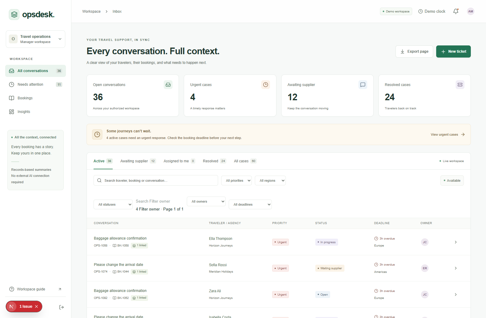
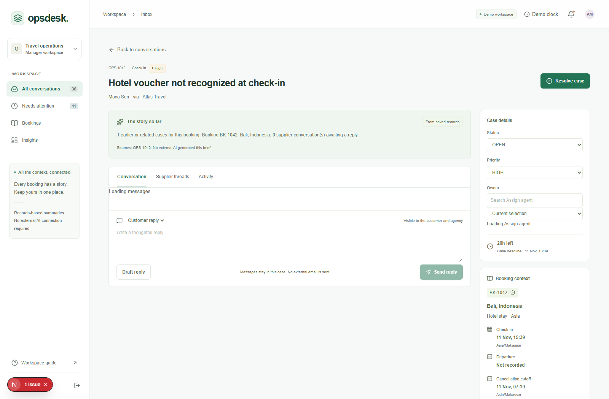
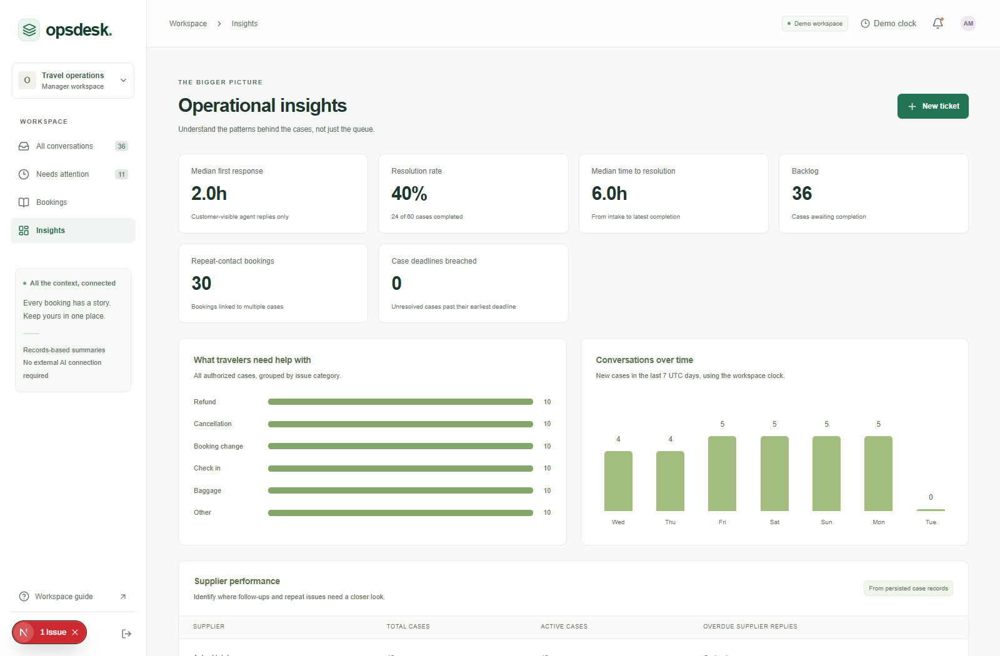
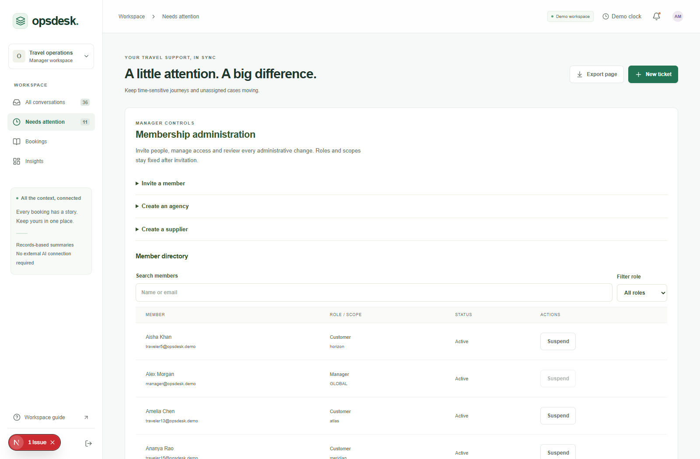

# OpsDesk - connected travel support

A local travel-support prototype that connects complaints to agencies, customers, bookings, earlier cases and private supplier conversations. Built with Next.js, NestJS, Prisma and PostgreSQL on the [IT Helpdesk foundation](https://github.com/Molnar-Zoltan/it-helpdesk).

Start with the [developer handoff](docs/OPSDESK_HANDOFF.md), [full setup and demo guide](OPSDESK_README.md), and [prioritized backlog](docs/OPSDESK_BACKLOG.md). Development and pull requests belong to [DhruvKhanna7777/opsdesk-travel-support](https://github.com/DhruvKhanna7777/opsdesk-travel-support).

## Screenshots

Real local screenshots using synthetic records. Select an image to open it at full size. Membership administration is included in this feature branch; it is not yet merged into `main`.

| Shared inbox | Booking-linked case |
| :---: | :---: |
| [](docs/assets/inbox-overview.png) | [](docs/assets/connected-case.png) |
| **Operational Insights** | **New membership administration** |
| [](docs/assets/insights-overview.png) | [](docs/assets/membership-overview.png) |

## Run locally

Use **Node.js 22.23.x** and npm. The local demo uses embedded PostgreSQL; Docker, an external database account and an AI API key are not required.

```sh
git clone https://github.com/DhruvKhanna7777/opsdesk-travel-support.git
cd opsdesk-travel-support
npm ci
npm run ops:preview
```

Open [http://127.0.0.1:3000](http://127.0.0.1:3000). On Windows, `Start-OpsDesk.cmd` also starts the demo. Use `npm run ops:dev` for frontend live reload.

The launcher creates local configuration, starts PostgreSQL on `127.0.0.1:55432`, applies migrations, seeds an empty travel workspace, builds the apps and starts the API on port 3001 and web app on port 3000. Run one launcher at a time. Existing configuration and records are preserved; database files live in the ignored `.opsdesk/postgres` directory. Initial startup takes longer while dependencies and database binaries install.

For your own dedicated development PostgreSQL instance, run `npm run ops:setup`, set `DATABASE_URL` in `backend/.env`, then use `npm run ops:preview -- --external-db`. This still applies migrations and seeds an empty demo; use a separate development database.

## Demo accounts

All seeded accounts use **`OpsDeskDemo!2026`**. Every operational record is synthetic.

| Email | Access |
| --- | --- |
| `manager@opsdesk.demo` | Manager across travel teams and agencies |
| `asia@opsdesk.demo` | Asia support agent |
| `europe@opsdesk.demo` | Europe support agent |
| `americas@opsdesk.demo` | Americas support agent |
| `global@opsdesk.demo` | Agent with global coverage |
| `agency@opsdesk.demo` | Atlas Travel agency |
| `horizon@opsdesk.demo` | Horizon agency |
| `maya@opsdesk.demo` | Maya's own bookings and customer-visible cases |
| `supplier@opsdesk.demo` | Aster Hotels' shared supplier conversations |
| `skyline@opsdesk.demo` | Skyline's shared supplier conversations |

The initial seed includes 3 agencies, 20 travelers, 30 bookings, 60 cases, 4 agents, 1 manager and 5 suppliers. It does not reset an existing workspace.

## What works

- Booking-linked complaints and authorized connected history, with separate records for separate cases.
- Regional queues, availability, agent specialties and capacity, automatic routing and manager reassignment.
- Customer replies, internal notes and separate supplier threads with role and agency boundaries enforced by the API.
- Travel deadlines, agency response targets, repeat-safe escalation and a persistent manager-only demo clock.
- Server-side Insights, searchable inbox filters and current-page case CSV export.
- On-demand case details and 20-row pages for messages, activity, related cases, booking history, supplier threads, bookings and people. Booking and staff selectors support search and paging.
- Compact workspace metadata, plus a compatibility full-workspace endpoint for older callers and tests.
- Records-based case briefs and editable reply drafts. External AI and real email delivery are not configured.

The application opens at `/`; travel API routes use `/ops/*`. The browser reaches the API through Next.js server routes. The local demo uses PostgreSQL-backed rate-limit and session-revocation counters; production requires Redis and rejects that local counter mode.

## Try the workflow

1. Sign in as the manager and open case **OPS-1042**, linked to booking **BK-1042**.
2. Review the booking, earlier cases, customer messages and internal notes.
3. Contact the supplier in a separate thread; sign in as `supplier@opsdesk.demo` to reply.
4. Return as manager, review the reply and record the case outcome.
5. Inspect Insights, then sign in as Maya to check that internal notes and supplier threads stay private.

The [full demo guide](OPSDESK_README.md#show-the-main-scenario) also covers deadline escalation with the demo clock.

## Validation and query profiling

Run checks in a second terminal against the isolated seeded demo:

```sh
npm run ops:test
npx playwright install chromium
npm run ops:test:browser
```

On this feature branch, `ops:test` passed 42 unit tests, 492 HTTP checks and 13 concurrency checks. It includes the new 80-check membership suite. `ops:test:browser` runs the existing five-role flow and the new membership flow; the final local Chromium/Firefox sequence was stopped at the user's request to prioritize GitHub publication. The earlier membership flow passed with the `msedge` channel. See the [exact pass/failure/fix record](docs/OPSDESK_VALIDATION.md). Suites create temporary fixtures and clean them up; use only the isolated synthetic demo. Run `npm run build` with the preview stopped to check both production builds independently.

The query-scaling follow-up adds `npm run ops:profile`. It requires an explicit `OPSDESK_PROFILE_DATABASE_URL` pointing to a local PostgreSQL maintenance `/postgres` database and an account allowed to create databases. Generate Prisma and build the backend first. The harness creates a disposable database, captures actual query plans and compares results before/after the reporting index. See [profiling method, timings and limits](docs/OPSDESK_QUERY_PROFILE.md) for configuration and reproduction.

Historical query-scaling local validation used Windows, Node.js 22.23.0 and PostgreSQL 18.6. Both builds, the migration, unit/HTTP/browser checks and changed-file lint passed. Existing full-backend lint errors in inherited files remain documented in the [validation notes](docs/OPSDESK_VALIDATION.md). Query timings are local synthetic measurements, not production performance targets.

## Project status and next work

**Deployment is paused at the user’s instruction: complete local features, verification and review first.** Saved free-demo deployment preparation is separate from this feature branch; no hosted service or live email is enabled.

PRs #15–#27 are merged at `f71b284487e0adad74a91ff15ac2da6554a2f525`. [Main CI passed](https://github.com/DhruvKhanna7777/opsdesk-travel-support/actions/runs/42805941972), including builds, recovery, core API checks, booking integration, Chromium, Firefox and production dependency audit. PRs #25–#27 deliver the offline classifier baseline, audited manager acknowledgment and synthetic booking export tooling.

Current unmerged work on `codex/opsdesk-membership-admin` adds manager invitations, public single-use activation, suspension/reactivation, session invalidation, agency/supplier creation and paged membership/audit controls. Invitation delivery is manual; identity scopes are immutable and historical records are preserved. Independent review's activation-quota finding is fixed and covered by passing unit/API tests. Browser completion and PR checks must be evaluated before merging. See [current branch evidence](docs/OPSDESK_VALIDATION.md#current-membership-branch-validation-10-november-2026).

Next implement contract business-hour/holiday/timezone calendars, shifts and escalation ownership; then email outbox/inbound webhooks and secure attachments, and a provider-neutral booking adapter with owner-approved creation/cancellation policy. Independent evaluation, accessibility, realistic concurrent load, recovery ownership and P0 live-data acceptance remain open. The [handoff](docs/OPSDESK_HANDOFF.md#13-remaining-work-in-priority-order) identifies entry files and acceptance checks.

Before live data, confirm production access rules, choose staging, rehearse backup/restore and configure monitoring. Live email, secure attachments, booking/supplier integrations, external AI evaluation and broader accessibility/security reviews remain pending. This repository documents a localhost prototype; it does not provide a production deployment.

## Documentation and source

| Guide | Contents |
| --- | --- |
| [Setup and demo](OPSDESK_README.md) | Launcher, accounts, full scenario and environment boundaries |
| [Developer handoff](docs/OPSDESK_HANDOFF.md) | Architecture, completed work and transfer notes |
| [Backlog](docs/OPSDESK_BACKLOG.md) | Prioritized remaining work and acceptance criteria |
| [Validation](docs/OPSDESK_VALIDATION.md) | Checks, evidence and known limitations |
| [Query profile](docs/OPSDESK_QUERY_PROFILE.md) | Synthetic-volume measurements and reproduction |
| [Sources](docs/OPSDESK_SOURCES.md) | Dataset attribution and reference material |
| [Upstream README](docs/IT_HELPDESK_README.md) | Historical IT Helpdesk documentation |

The original repository history and authorship are retained. The included Bitext Travel examples are complaint wording samples, not actual bookings or supplier policies; their attribution and terms are recorded in the sources guide.


Lock contention follow-up: ticket messages and supplier operations now serialize per ticket; routing retains its capacity lock. Escalation uses fresh-state transactions in batches of 100 candidates. `npm run ops:test` includes the multi-connection lock regression harness. See [lock protocol and limitations](docs/OPSDESK_VALIDATION.md).

## Historical synthetic recovery rehearsal - 10 November 2026

Added `npm run ops:recovery` and five connection-safety tests. The rehearsal creates two disposable local databases, migrates/seeds the source, dumps/restores a custom archive, compares all public row data/indexes/constraints and tests restored integrity enforcement. See [runbook and limitations](docs/OPSDESK_RECOVERY.md). Local safety tests passed on Node 22.23.0; full archive/restore validation runs in CI using PostgreSQL 18 client tools because this Windows machine has only the embedded server binaries. CI results must be checked before claiming recovery validation. This is partial progress on issue #3; operational backups, retention, staging restore and production recovery ownership remain open. The branch is based on merged main and has no dependency on unmerged PR #17.

## Historical production configuration follow-up - 10 November 2026

Added early production startup validation for disabled demo/local-counter modes, separate non-placeholder JWT secrets, exact HTTPS frontend origins, PostgreSQL/Redis URL schemes, and non-test Turnstile settings. Environment typos fail explicitly and configuration errors do not echo secret values. See [settings and limits](docs/OPSDESK_PRODUCTION_CONFIG.md). Local validation includes 28 unit tests, changed-file lint, backend compilation and a real bootstrap rejection of the generated local-demo environment under NODE_ENV=production. These are sanity checks, not provider credential verification, automatic account cleanup or production deployment. This issue #3 follow-up is independent of unmerged PRs #17 and #18 and based on main fcd75fa.

Workspace dialogs support keyboard navigation with Tab, Shift+Tab and Escape. Closing a dialog returns focus to its launcher when it is still on the page.

For Firefox coverage, install the matching browser with `npx playwright install firefox`, set `OPSDESK_BROWSER_ENGINE=firefox` in your shell and run `npm run ops:test:browser`. Chromium is the default.

Session refresh tokens are single-use. The HTTP smoke suite forces overlapping requests for the same token, and the browser suite checks that a stale response preserves the replacement cookies.
